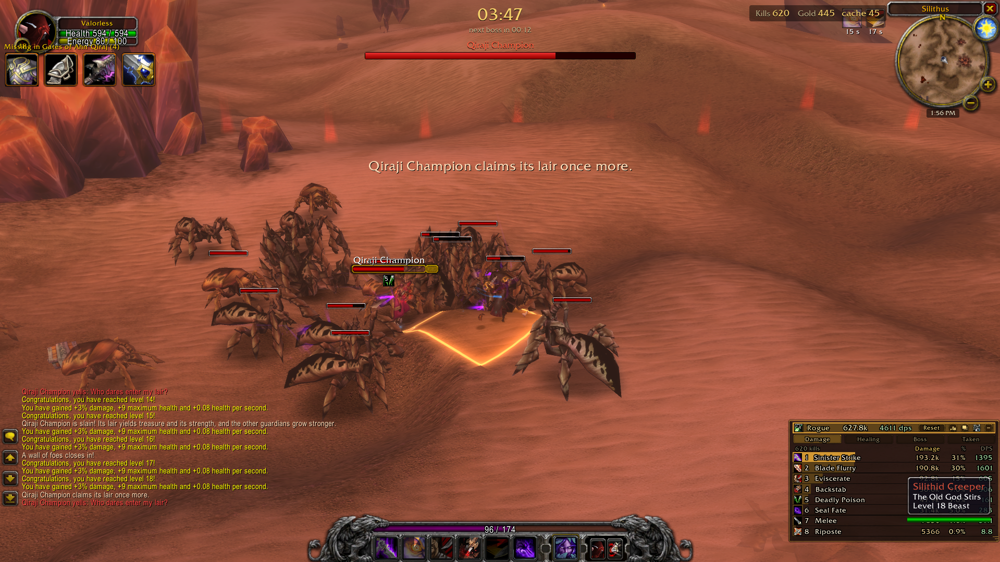
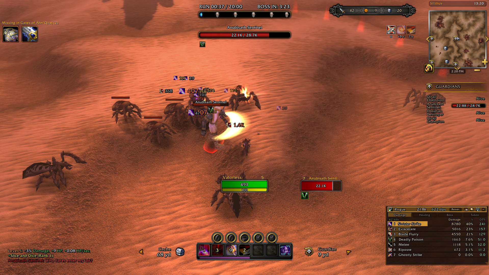

# ASTinyPlates

A World of Warcraft Classic (1.12) addon that declutters the screen by shrinking nameplates of regular mobs, while keeping the ones that matter — bosses and guardians — easy to read.

## Features

- **Tiny regular plates** – ordinary mob nameplates are shrunk to half size.
- **Full-size boss and guardian plates** – these keep their normal size and show:
  - a name label
  - a status bar
  - debuff icons with timers
- **Works with UI replacements** – tested with the default UI and with SDUI.

## Screenshots

**Default (vanilla) UI** – regular mobs get small bars, while the Qiraji Champion keeps a full-size plate with name, status bar and debuff icon.

**With SDUI** – the same behaviour with the SDUI UI replacement; the Anubisath Sentinel plate shows its name, status bar and a debuff icon.

## Requirements

- WoW Classic 1.12 client (Interface `11200`)
- The **AZS** addon. Boss/guardian detection and debuff data come from AZS (`AZS_` functions).

## Installation

1. Download the latest version from the [Releases](../../releases) page.
2. Copy the `ASTinyPlates` folder into `Interface/AddOns`.
3. Restart the game (or reload the UI) and make sure the addon is enabled.

## Commands

| Command | Description |
| --- | --- |
| `/astpdebug` | Prints debug information about the visible boss/guardian nameplates to the chat frame. |

## Releases

Releases are published automatically on GitHub Releases whenever a pull request is merged into `main` (see [`.github/workflows/release.yml`](.github/workflows/release.yml)).
