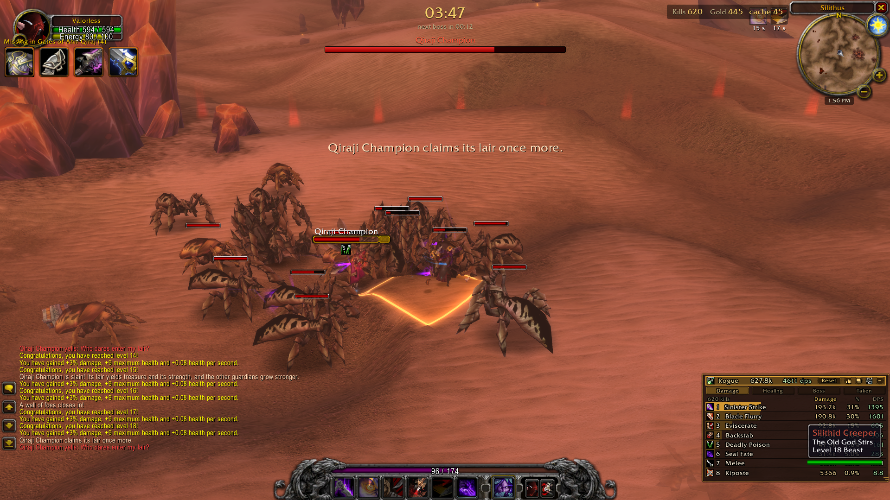
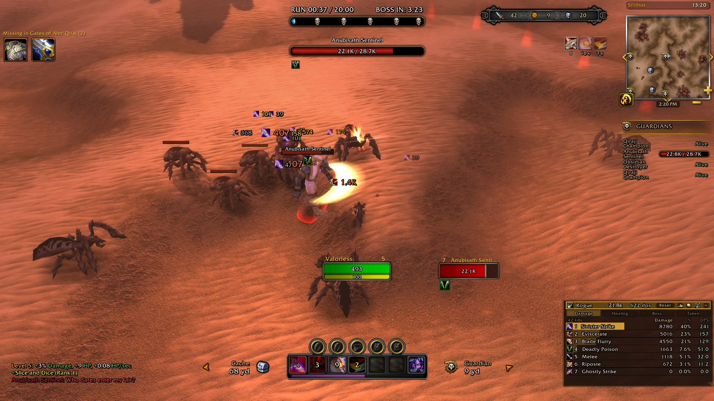

# ASTinyPlates

An **Azeroth Survivors** addon that declutters the screen by shrinking nameplates of regular mobs, while keeping the ones that matter — bosses and guardians — easy to read.

## Features

- **Tiny regular plates** – Ordinary mob nameplates are shrunk to half size.
- **Full-size boss and guardian plates** – These keep their normal size and show:
  - A name label
  - A status bar
  - Debuff icons with timers
- **Works with UI replacements** – Tested with the default UI and with SDUI.
- **Settings window and minimap button** – A dragon minimap button (click to open, drag to move it round the minimap; the position is saved) or `/astp` opens the settings window. Changes apply immediately and are saved in `ASTinyPlatesDB`.
- **Custom bar colors** *(colorblind support)* - Choose any color you prefer for the plates.

## Settings

| Option | Default | Description |
| --- | --- | --- |
| Show debuffs | On | Show the debuff icons with timers below boss and guardian plates. |
| Hide the name on boss/guardian plates | Off | Hide the name above boss and guardian plates. |
| Hide regular plates | Off | Hide the shrunken regular plates completely, leaving only boss and guardian plates (requires Overlapping nameplates). |
| Show the name on regular mob plates | Off | Show the mob's name above shrunken plates (not used while regular plates are hidden). |
| Custom bar color (boss/guardian) | Off | Color boss and guardian health bars yourself instead of the game's colors. |
| Custom bar color (regular) | Off | Color the shrunken regular health bars yourself. |

## Screenshots

**Default (vanilla) UI** – regular mobs get small bars, while the Qiraji Champion keeps a full-size plate with name, status bar and debuff icon.

**With SurvivorsDragonUI** – the same behaviour with the SDUI UI replacement; the Anubisath Sentinel plate shows its name, status bar and a debuff icon.

## Installation

1. Download the latest version from the [Releases](../../releases) page.
2. Copy the `ASTinyPlates` folder into `/AddOns`.
3. Restart the game (or reload the UI) and make sure the addon is enabled.

## Known Quirks

- If an Elite and Guardian of the same mob is present at the same time, the Elite will show the debuffs of the Guardian.
- Elites do not show their debuffs, due to missing GUID.
- Plates of Guardians may appear as shrunken for a quick second when first viewed.

## Commands

| Command | Description |
| --- | --- |
| `/astp` (or `/astinyplates`) | Opens or closes the settings window. |
| `/astpdebug` | Prints debug information about the visible boss/guardian nameplates to the chat frame. |

## Releases

Releases are published automatically on GitHub Releases whenever a pull request is merged into `main` (see [`.github/workflows/release.yml`](.github/workflows/release.yml)).

## How it works, quick TLDR

ASTinyPlates will draw placeholders on-top of regular nameplates and hide the real ones, as scaling the original plates proved to cause issues.
All plates are by default shrunken, where they're then checked against the zone's Guardians and Bosses, in order to tell if the nameplate belongs to one of those.

## AI Usage

ASTinyPlates is created using GitHub Copilot (Claude Sonnet 5.5), since I'm not very knowledgeable in Lua nor the 1.12 WoW API
